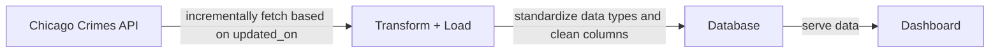

# **README**

# **1\. Team**

**Team Number: 7**  
**Group Leader: Hunter Cruce**

* **Yohan Arul \- yohanarul@tamu.edu**  
* **Ethan Rasmussen \- ethan.rasmussen@tamu.edu**   
* **Navya Vegesna \- nvv2006@tamu.edu**  
* **Hunter Cruce \- huntercruce@tamu.edu** 

# **2\. Data Source**

## **Primary Dataset Overview**

The team selected the Chicago Crimes Dataset that dates back to 2001. This dataset contains information about reported crimes in Chicago, including the date, type of crime, and location.   
 

* **Dataset Name**: Chicago Crimes  
* **Source**: Options File  
* **JSON URL**: [https\://data.cityofchicago.org/resource/ijzp-q8t2.json](https://data.cityofchicago.org/resource/ijzp-q8t2.json)   
* **Dataset URL**: [https\://data.cityofchicago.org/Public-Safety/Crimes-2001-to-Present/ijzp-q8t2/data\_preview](https://data.cityofchicago.org/Public-Safety/Crimes-2001-to-Present/ijzp-q8t2/data_preview)  
* **API Key**: Must use a socrata app token and API key.
* **Incremental Pulls**: We plan to use the updated\_on column to identify crime records that have been added or modified since the last successful data pull. We will also use the id column to identify each crime record and prevent duplicates when loading the data into PostgreSQL.


# **3\. Data Direction and Description**

**Direction** The team decided to pull from 2026 -> present in order to get the most insights with the least computational load. This will allow the dashboard to visualize crime patterns throughout a full year on January 1st, which is a final underlying question: **How is crime rate affected by season**.

**Questions:**

1. Which areas of Chicago have the most reported crimes?  
2. Is there a correlation between types of crime and regions in the city?  
3. Is crime density per region proportional to population density?  
4. How have crime patterns changed over time in different regions of Chicago?  
5. What are the most common types of crime reported in Chicago?

| Column Name | Type |
| :---- | :---- |
| case\_number | String (VARCHAR) |
| primary\_type | String (VARCHAR) |
| arrest | Bool |

**Source Update Frequency:** Daily

## **Database Tables:**  

**dim_crime_type:** Stores crime type and fbi code.

**dim_location:** Stores the locations such as beat, community area, and lat/long coordinates. 

**fact_crime** This contains the unique facts about each individual crime.

# **4\. Architecture**



# **5\. Setup**

Copy `.env.sample` to `.env` and fill in your Socrata API URL/app token (see [data.cityofchicago.org](https://data.cityofchicago.org/profile/app_tokens) to request one) and PostgreSQL credentials:

```bash
cp .env.sample .env
```

# **6\. Run Pipeline**

```bash
docker compose up
```
ctrl + c to stop 